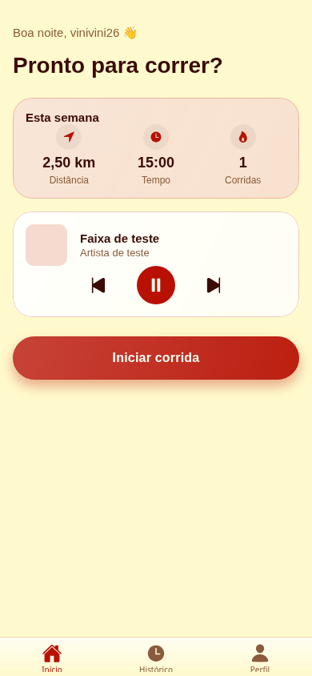
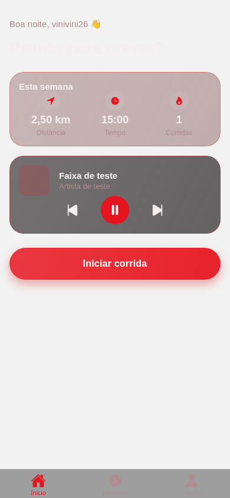
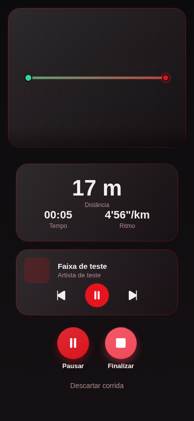
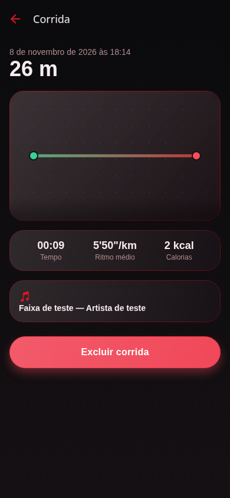

# Trabalho 3 — RotaFit | vinivini26

Projeto 3 da série de Programação para Dispositivos Móveis: aplicativo Android/iOS
para acompanhar corridas com GPS, guardar o histórico e controlar o Spotify.
Baseado no **RotaFit — Guia Passo a Passo**, Prof. Me. Bruno Assunção Dias / IESB,
outubro de 2026. FinTrack e MarketGo são projetos independentes do mesmo repositório.

[← Voltar aos três trabalhos](../README.md) · [Documentação do RotaFit](docs/README.md)

## Onde encontrar cada arquivo

| Caminho | Conteúdo |
| --- | --- |
| `app/` | Telas de login, início, corrida, histórico, resumo e perfil. |
| `src/components/` / `src/theme/` | Componentes visuais e temas claro/escuro. |
| `src/hooks/` / `src/utils/` | Rastreamento GPS, relógio e regras da corrida. |
| `src/context/` / `src/lib/` / `src/services/` | Sessões, OAuth, armazenamento e acesso aos serviços. |
| `src/types/` | Tipos compartilhados pelo aplicativo. |
| `__tests__/` | Testes das regras, dos hooks e do salvamento. |
| `supabase/` | Schema SQL, permissões e testes do banco. |
| `scripts/` | Verificações de interface com serviços simulados. |
| `package.json` / `package-lock.json` | Comandos, dependências e versões. |
| `app.json` / `tsconfig.json` / `.env.example` | Configuração do Expo, TypeScript e exemplo de variáveis. |
| [docs/](docs/README.md) | Relatório, testes, compilação e capturas deste trabalho. |

## Funcionalidades

- Login com Google via Supabase Auth e PKCE, sem senha própria ou client secret no app.
- GPS em primeiro plano: distância, duração, ritmo, iniciar, pausar, retomar e finalizar.
- Filtro de saltos implausíveis e baixa precisão; deslocamento durante pausa não soma distância.
- Traçado em SVG, sem mapa pago nem chave de mapas.
- Histórico, resumo, exclusão e estatísticas semanais, com isolamento por usuário via RLS.
- Spotify com OAuth/PKCE, tokens no SecureStore nativo, renovação, faixa atual e controles.
- Tema claro Milano Red/Lemon Chiffon, escuro inspirado no Flamengo e preferência do sistema.
- Visual de vidro leve: transparência, reflexos em degradê, bordas suaves e temas claro/escuro.
- Áreas seguras, rolagem e alvos de toque para telas pequenas.
- Falha de salvamento permite repetir o mesmo payload sem criar outra corrida se a primeira
  gravação tiver sido concluída antes de uma queda de conexão.

## Executar no Android

Requisitos: **Node 22 LTS ou superior**, npm, JDK 17, Android SDK compatível e um
celular/emulador. A configuração nativa usa SDK/Build Tools 36 e NDK 27.1.12297006. As versões das bibliotecas estão alinhadas ao Expo SDK 57.

```sh
cd rotafit
npm ci
cp .env.example .env
```

Preencha `.env` com a URL e a chave **pública** do Supabase e o Client ID do Spotify.
Nunca use chave `service_role`, senha do banco ou client secret no aplicativo.

1. Crie um projeto Supabase próprio para o RotaFit.
2. Execute `supabase/schema.sql` **uma única vez** no SQL Editor de um projeto novo.
   O script cria tabelas; não é uma migração idempotente. Não execute sobre o banco do MarketGo.
3. No Google Cloud, configure a tela de consentimento e crie um cliente OAuth do tipo Web.
   Cadastre como URI autorizada a URL de callback exibida pelo Supabase, normalmente
   `https://SEU-PROJETO.supabase.co/auth/v1/callback`.
4. No Supabase, habilite Google em Authentication → Providers e informe Client ID/Secret
   **no painel do servidor**. Em URL Configuration → Redirect URLs, autorize
   `rotafit://auth/callback`. Em modo de testes do Google, autorize também os usuários de teste.
5. No Spotify for Developers, crie o aplicativo e cadastre `rotafit://spotify-auth` como
   redirect URI; autorize a conta de teste conforme as regras do painel Spotify.
6. Com o celular conectado por USB e depuração habilitada, execute:

```sh
npm run android
```

Esse comando cria o projeto Android nativo, compila, instala e inicia o Metro. Para
reabrir uma compilação de desenvolvimento já instalada, use `npm start`.
Para iOS: macOS/Xcode e `npm run ios`.

**Login OAuth deve ser homologado em uma compilação nativa de desenvolvimento.**
O Expo Go pode servir para inspeções compatíveis com o SDK, mas não é a referência
para o retorno OAuth por esquema próprio. Se usar outro ambiente, confira o URI
produzido por `makeRedirectUri` e cadastre exatamente esse valor nos provedores.

Sem configuração do Supabase, o aplicativo mostra uma tela de configuração inicial;
isso não representa login, conexão ou corrida concluídos.

## Testes e verificações

```sh
npm run typecheck
npm test
npx expo export --platform android
```

Os testes do banco usam PGlite com o mesmo schema do Supabase, sem Docker e sem
credenciais externas. Cobrem permissões, RLS, restrições e estatísticas.

Para a interface, instale Chromium do Playwright e rode:

```sh
npx playwright install chromium
npm run test:ui
```

O script inicia o Expo local e simula Supabase, sessão, Spotify e GPS **somente no
processo de teste**. Verifica login, histórico vazio, tema persistente, corrida, resumo,
exclusão, Spotify sem permissão e nova tentativa após falha, em 320×568, 390×844 e
768×1024. Para Chromium instalado no sistema, informe `CHROMIUM_PATH`.
Para um servidor de teste já iniciado com as variáveis fictícias indicadas no script,
informe `ROTAFIT_UI_URL`. O navegador é um instrumento de teste, não a plataforma
homologada do aplicativo.

O visual usa React Native e `expo-linear-gradient`, sem `expo-blur` e sem a dependência
BlurView hospedada no JitPack. Essa simplificação foi solicitada pelo usuário e mantém
as cores, os cartões, os botões e a navegação nos dois temas.

Resultados e limitações: [relatório](docs/RELATORIO_DESENVOLVIMENTO.md),
[logs automatizados](docs/VALIDACAO.txt) e [verificações da interface](docs/VALIDACAO_UI.txt).

## APK pelo GitHub Actions

**APK gerado com sucesso:** [baixar RotaFit-homologacao-arm64](https://github.com/vinivini26/Trabalho-dispositivos-mobile-/actions/runs/42512010957/artifacts/13630012629)
(arquivo ZIP, aproximadamente 27,5 MB; contém APK e checksum).
[Execução aprovada](https://github.com/vinivini26/Trabalho-dispositivos-mobile-/actions/runs/42512010957): 52 testes passaram e o build nativo concluiu em 13m35s.
O código compilado corresponde ao commit `3075375`.

Para gerar uma nova versão, abra **Actions → RotaFit - Testes e APK → Run workflow**.
Ao concluir, baixe **Artifacts → RotaFit-homologacao-arm64**. O JavaScript está incluído
no APK; não precisa manter o Metro aberto. Os artefatos ficam disponíveis por 14 dias.

O APK é para homologação, usa a chave de assinatura de desenvolvimento do template
Expo e não é uma versão assinada para publicação em loja. Para configurar as integrações,
defina as três variáveis públicas `EXPO_PUBLIC_*` em **Settings → Secrets and variables →
Actions → Variables** do repositório antes de executar. Sem elas, o app mostra configuração
inicial; isso não equivale a login/corrida homologados. Não coloque segredos de servidor
nessas variáveis. Nunca use `service_role` ou client secret no bundle.

A compilação foi concluída no GitHub Actions. O registro da tentativa local bloqueada
por rede permanece no relatório como histórico; a geração do APK foi confirmada no CI.

## Capturas

Capturas de Chromium com **conta, música, backend e GPS simulados para testes**.
Não são evidência de login social real nem de corrida em aparelho físico.

| Início claro | Início escuro | Corrida | Resumo |
| --- | --- | --- | --- |
|  |  |  |  |

## Custo e comportamento esperado

O traçado SVG dispensa serviço de mapas. Supabase e OAuth usam os planos gratuitos
quando disponíveis; limites e regras dos provedores continuam aplicáveis. Para comandos
remotos de reprodução, o Spotify exige conta Premium autorizada e um dispositivo ativo.
O app controla a sessão do Spotify; não transmite áudio por conta própria.

O GPS é de **primeiro plano**. Ao minimizar o app ou bloquear a tela, a corrida é
pausada. Reabra e toque em Retomar. Não há rastreamento em segundo plano nesta entrega.
Sem internet, o rastreamento em primeiro plano continua; a gravação depende do Supabase.
Em caso de falha, mantenha a tela aberta e tente salvar novamente: não há fila offline
persistente para recuperar uma corrida depois de encerrar o processo do app.
As calorias são uma estimativa de referência com peso padrão de 70 kg.

## Arquitetura

```text
app/                 rotas, login, abas e telas de corrida
src/components/      interface, vidro, tema, player e traçado SVG
src/context/         sessão Google e Spotify
src/hooks/           consultas, mutações e conexão entre GPS e reducer
src/lib/             clientes, OAuth e armazenamento seguro
src/services/        Supabase e API Spotify
src/theme/           tokens e preferência persistente
src/utils/           regras puras de geolocalização, relógio e estados
supabase/            schema, RLS, função semanal e testes locais
__tests__/           testes de regras, falhas de GPS e repetição de salvamento
scripts/             verificações de interface com serviços simulados
```

Dependências: tela → hook → serviço → banco/API. A sessão Spotify é isolada por
usuário; as consultas são limpas ao sair da conta. Não foram fornecidas credenciais
reais nesta entrega. Google, Spotify real e GPS ao ar livre precisam da homologação
manual descrita no relatório.

Autor: **[vinivini26](https://github.com/vinivini26)**.
