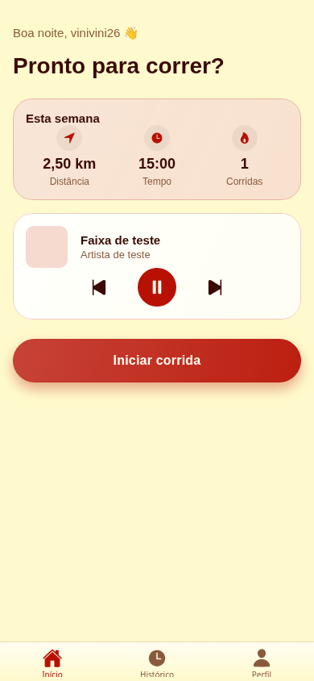
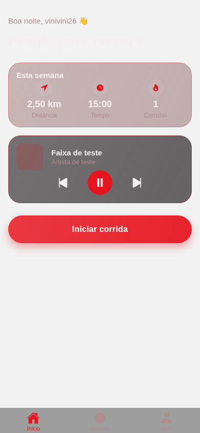
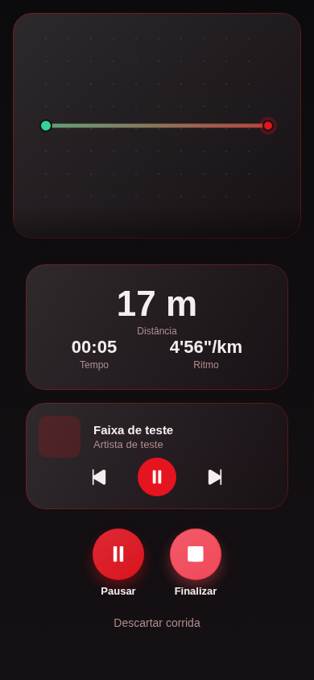
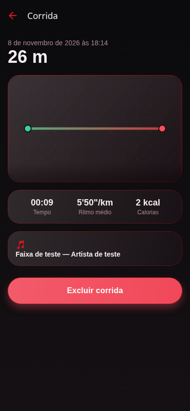

# Capturas de interface — RotaFit

[← Documentação do RotaFit](../README.md) · [Apresentação do projeto](../../README.md)

As imagens foram produzidas em Chromium, com conta, backend, música e GPS **simulados
para testes**. Não representam login social nem corrida homologados em aparelho físico.

## Visão principal em celular

| Início claro | Início escuro |
| --- | --- |
|  |  |

| Corrida em andamento | Resumo da corrida |
| --- | --- |
|  |  |

## Índice por tela e tamanho

Os sufixos dos arquivos indicam a largura da tela: **320** (320×568), **390** (390×844)
e **768** (768×1024). As telas podem rolar verticalmente.

| Tela | Celular compacto — 320 | Celular — 390 | Tablet — 768 |
| --- | --- | --- | --- |
| Início claro | [Abrir](inicio-claro-320.png) | [Abrir](inicio-claro-390.png) | [Abrir](inicio-claro-768.png) |
| Início escuro | [Abrir](inicio-escuro-320.png) | [Abrir](inicio-escuro-390.png) | [Abrir](inicio-escuro-768.png) |
| Perfil escuro | [Abrir](perfil-escuro-320.png) | [Abrir](perfil-escuro-390.png) | [Abrir](perfil-escuro-768.png) |
| Corrida | [Abrir](corrida-320.png) | [Abrir](corrida-390.png) | [Abrir](corrida-768.png) |
| Resumo | [Abrir](resumo-320.png) | [Abrir](resumo-390.png) | [Abrir](resumo-768.png) |
| Login | [Abrir](login-320.png) | — | — |
| Configuração sem credenciais | [Abrir](configuracao-320.png) | — | — |
